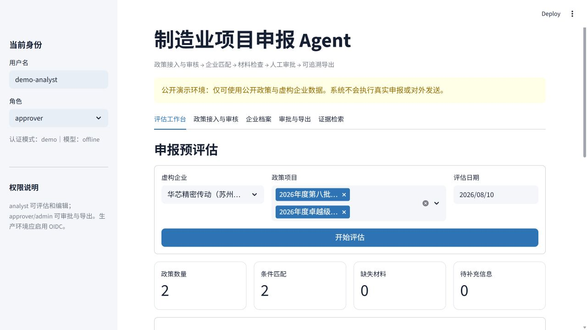
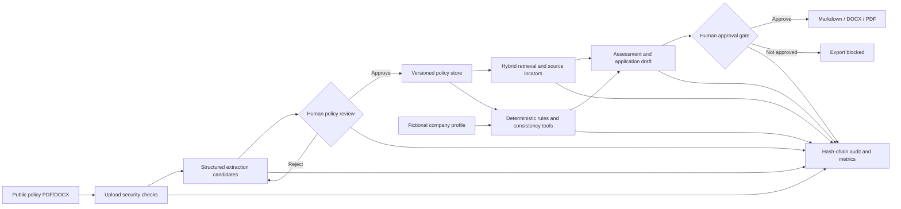

[简体中文](README.md) | [English](README.en.md)

# Manufacturing Project Application Agent

A runnable agent system for manufacturing policy applications. It ingests public policies, creates human-reviewable structured drafts, matches fictional company profiles, checks materials and consistency, prepares fact-bound application drafts, and exports DOCX/PDF files only after human approval. Every decision retains source locators and a hash-chained audit trail.

> Safety boundary: the public repository uses government-public documents and fictional companies only. It never performs real submission, email delivery, or external-system writes.



## Version 0.2 capabilities

- PDF/DOCX policy upload with signature, size, sensitive-field, and SHA-256 checks;
- offline extraction fallback or configurable OpenAI-compatible structured extraction;
- policy version workflow: `draft → approved/rejected` before a policy can enter assessment;
- hybrid BM25, character n-gram TF-IDF, and exact number/phrase reranking;
- deterministic eligibility, application-window, material, and consistency checks;
- explicit abstention on unknown facts—no generated subsidy amounts, dates, or company facts;
- company JSON editor, approval console, and Markdown/DOCX/PDF export;
- SQLite locally, PostgreSQL compatibility, and background assessment jobs;
- demo identity plus production OIDC/JWT with `viewer/analyst/approver/admin` roles;
- SHA-256 hash-chain auditing, JSON logs, request IDs, and Prometheus metrics;
- FastAPI, Streamlit, Docker Compose, Render Blueprint, CI, CodeQL, and Dependabot.

## Architecture



The language model proposes structured candidates only. Deterministic code owns eligibility, amount handling, material status, and permission gates.

## Included public demonstrations

1. [2026 Smart Factory Tiered Cultivation Program](https://www.miit.gov.cn/zwgk/zcwj/wjfb/tz/art/2026/art_bbccc17a650749c2a76569679350fa5d.html)
2. [2026 Specialized and Innovative “Little Giant” Recognition](https://www.miit.gov.cn/jgsj/qyj/wjfb/art/2026/art_83857a4773ac4583bd1540eeb78bcbcb.html)

Every company profile has `fictional=true`. Neither notice promises a uniform subsidy, so the system reports the amount as unspecified rather than inventing one.

## Run locally

Python 3.11+ is required.

```powershell
git clone https://github.com/jiaotashidi-bi/manufacturing-project-agent.git
cd manufacturing-project-agent
python -m venv .venv
.\.venv\Scripts\Activate.ps1
pip install -e ".[dev]"
Copy-Item .env.example .env
```

Start the workspace:

```powershell
streamlit run app.py
```

Start the API and interactive documentation:

```powershell
uvicorn manufacturing_agent.api:app --reload
# http://127.0.0.1:8000/docs
```

Run quality gates:

```powershell
ruff check src tests scripts app.py
coverage run -m pytest
coverage report
python scripts/evaluate.py
```

## Docker

```powershell
docker compose up --build
```

- Streamlit: <http://localhost:8501>
- FastAPI: <http://localhost:8000/docs>
- PostgreSQL state is stored in a Compose volume.

The Compose database password is for local demonstration only. Use a secret manager in a real deployment.

## Configure a language model

The default `MPA_LLM_PROVIDER=offline` needs no credentials. For an OpenAI-compatible endpoint, set these values in a local `.env` or deployment secret manager:

```dotenv
MPA_LLM_PROVIDER=openai_compatible
MPA_LLM_BASE_URL=https://api.openai.com/v1
MPA_LLM_MODEL=gpt-5-mini
MPA_LLM_API_KEY=...
```

Never commit credentials. Model output still passes structured validation and human policy review.

## Production authentication

Demo mode accepts role headers for local use. Production enforces OIDC:

```dotenv
MPA_ENVIRONMENT=production
MPA_AUTH_MODE=oidc
MPA_OIDC_ISSUER=https://identity.example.com/
MPA_OIDC_AUDIENCE=manufacturing-project-agent
MPA_OIDC_JWKS_URL=https://identity.example.com/.well-known/jwks.json
MPA_OIDC_ROLE_CLAIM=roles
```

The API validates the Bearer JWT signature, issuer, audience, lifetime, and role claim. Production does not trust a client-supplied `X-Role`.

## API summary

| Capability | Endpoint |
|---|---|
| Health and metrics | `GET /health`, `GET /metrics` |
| Policy intake/review | `POST /policy-drafts/upload`, `POST /policy-drafts/{id}/versions/{v}/review` |
| Company profiles | `GET /companies`, `PUT /companies/{id}` |
| Sync/background assessment | `POST /assess`, `POST /jobs/assess`, `GET /jobs/{id}` |
| Approval/audit | `POST /runs/{id}/approval`, `GET /runs/{id}/audit/verify` |
| Document export | `GET /runs/{id}/exports/{md|docx|pdf}` |
| Evidence search | `GET /search?q=...` |

Export requires an `approver` or `admin` role and an approved run.

## Evaluation baseline

Current `python scripts/evaluate.py` results:

| Metric | Result |
|---|---:|
| Eligibility/window accuracy | 100% |
| Retrieval Recall@1 / @3 / @5 | 85% / 95% / 95% |
| Retrieval MRR | 0.90 |
| Citation locator coverage | 100% |
| Unknown-fact abstention | 100% |
| Amount hallucination rate | 0% |
| Material coverage | 100% |
| Audit-chain validity | 100% |

This remains a small public-policy regression set; the figures are not evidence of cross-region or cross-industry generalization.

## Data and security

Allowed: government-public policies, guidance, forms, fictional companies, and simulated materials.

Prohibited: real company financial/R&D/process/customer data, personal data, non-public listing materials, credentials, cookies, tokens, API keys, seals, and signatures. See [SECURITY.md](SECURITY.md).

## License and disclaimer

Code is licensed under the [MIT License](LICENSE). The latest issuing-authority publication remains authoritative. This project does not replace a regulator, lawyer, accountant, or internal corporate approval process.
