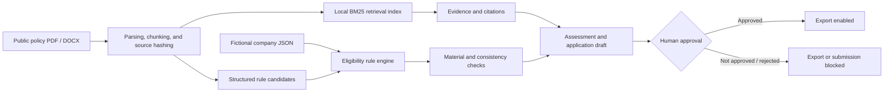

[简体中文](README.md) | [English](README.en.md)

# Manufacturing Project Application Agent

A locally runnable, citation-first manufacturing policy application assessment system that blocks real submission by default. The project uses only public documents published by China's Ministry of Industry and Information Technology and entirely fictional company data, making it suitable as an Agent/RAG engineering portfolio project.

The first runnable version includes:

- PDF and DOCX ingestion with a reproducible local retrieval index;
- candidate extraction for dates, amounts, percentages, thresholds, and required materials, followed by human-reviewed policy rules;
- rule-by-rule matching between company facts and mandatory policy requirements;
- separate evaluation of the application window and company eligibility;
- source links and page/section locators for every decision;
- checks for missing materials, inconsistent financial ratios, and cross-document conflicts;
- fact-bound application drafting that marks unknown information instead of inventing it;
- a complete execution audit trail;
- role-based access control and a human approval gate before export;
- FastAPI, Streamlit, CLI, automated tests, and a compact golden evaluation set.

## Included Policy Demonstrations

1. [2026 Smart Factory Tiered Cultivation Program](https://www.miit.gov.cn/zwgk/zcwj/wjfb/tz/art/2026/art_bbccc17a650749c2a76569679350fa5d.html): on the demonstration date of August 10, 2026, applications for the Excellent-level Smart Factory program close on August 15, 2026.
2. [2026 Specialized and Innovative “Little Giant” Recognition](https://www.miit.gov.cn/jgsj/qyj/wjfb/art/2026/art_83857a4773ac4583bd1540eeb78bcbcb.html): online applications ran from April 25 to May 25, 2026, so the window is closed on the demonstration date.

Neither national notice promises a uniform financial subsidy. The system therefore reports the amount as “not specified” instead of generating a plausible-looking number.

## Quick Start

```powershell
cd D:\Xinhua\Agent\manufacturing-project-agent
python -m venv .venv
.\.venv\Scripts\Activate.ps1
pip install -e ".[dev]"
```

Start the visual interface:

```powershell
streamlit run app.py
```

Start the API:

```powershell
uvicorn manufacturing_agent.api:app --reload
```

Open `http://127.0.0.1:8000/docs` to use the interactive API documentation.

Run the CLI demonstration:

```powershell
manufacturing-agent-demo --company huaxin_precision --as-of 2026-08-10
```

Rebuild the public-document retrieval index and display source hashes:

```powershell
python scripts/ingest_sources.py
```

Run tests and golden evaluations:

```powershell
pytest
python scripts/evaluate.py
```

## Core Workflow



The design principle is: language models may help with interpretation and drafting, while deterministic code owns mandatory conditions, calculations, permissions, and auditability. The current offline version completes the core workflow with reproducible rules and templates and requires no API key. A language model can later enhance prose without changing the decision or approval boundaries.

## Data and Privacy Boundaries

- `data/raw/`: public policies and application forms from official MIIT websites;
- `data/companies/`: three entirely fictional companies;
- `data/policies/`: human-reviewed structured rules and citations;
- `data/runtime/` and `exports/`: generated at runtime and excluded from Git by default;
- public demonstration mode refuses company profiles with `fictional=false`;
- the project does not connect to a real government application platform and contains no real submission tool.

This project is not a substitute for an official policy authority, legal counsel, an accountant, or an internal corporate approval process. Policies may change and must be revalidated against the latest official documents before formal use.

## Permission Model

| Operation | analyst | approver | admin |
|---|---:|---:|---:|
| Assess, retrieve, and draft | Yes | Yes | Yes |
| Decide an approval gate | No | Yes | Yes |
| Export approved materials | No | Yes | Yes |
| Submit to a real external system | Not implemented | Not implemented | Not implemented |

The API's `X-Role` header is only a local demonstration mechanism and is not production authentication. A production deployment must replace it with organizational identity, fine-grained authorization, and tamper-resistant audit storage.

## Repository Structure

```text
manufacturing-project-agent/
├─ app.py                         # Streamlit UI
├─ data/
│  ├─ raw/                        # Official public source files
│  ├─ policies/                   # Structured policies and citations
│  ├─ companies/                  # Fictional company profiles
│  └─ evals/                      # Golden evaluation cases
├─ src/manufacturing_agent/
│  ├─ ingestion.py                # PDF/DOCX ingestion and hashing
│  ├─ retrieval.py                # Chinese-friendly local BM25 retrieval
│  ├─ eligibility.py              # Mandatory conditions and materials
│  ├─ consistency.py              # Ratios and cross-document consistency
│  ├─ drafting.py                 # Fact-bound application drafting
│  ├─ workflow.py                 # Agent workflow, approval, and audit
│  └─ api.py                      # FastAPI
├─ scripts/                       # Ingestion, extraction review, evaluation
└─ tests/                         # Workflow and permission tests
```

See [Architecture](docs/ARCHITECTURE.md), [Security and Data Policy](SECURITY.md), and the [Demo Script](docs/DEMO.md) for additional details.

## License

The source code is released under the MIT License. Rights and usage terms for original policy documents remain with their publishing authorities and original rights holders. Public copies are retained here solely for citation, verification, and educational demonstration, together with their official source links.
