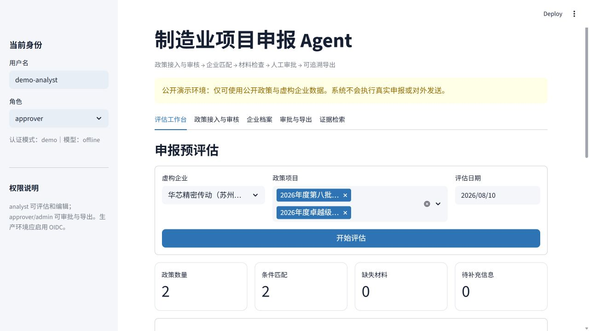
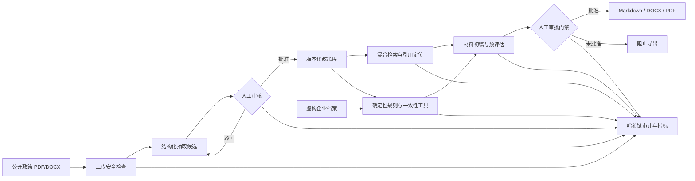

[简体中文](README.md) | [English](README.en.md)

# 制造业项目申报 Agent

面向制造业政策申报场景的可运行 Agent 系统：接入公开政策，提取结构化审核草稿，匹配虚构企业档案，检查材料与数据一致性，生成申报材料初稿，并在人工批准后导出 DOCX/PDF。每个判断保留原文定位与哈希链审计记录。

> 安全边界：公开仓库仅使用政府公开文件和虚构企业数据；系统不执行真实提交、邮件发送或外部系统写入。



## 第二版能力

- PDF/DOCX 政策上传、文件签名/大小检查、敏感字段提示和来源 SHA-256；
- 离线正则回退或 OpenAI-compatible 结构化抽取，所有抽取结果先进入草稿；
- 政策版本状态机：`draft → approved/rejected`，未经人工批准不进入评估库；
- BM25 + 字符 n-gram TF-IDF + 数字/短语精排的混合检索；
- 确定性资格规则、申报窗口判断、材料检查和跨材料一致性检查；
- 未知事实明确返回“待补充”，不让生成模型补齐金额、日期或企业事实；
- 企业 JSON 编辑器、审批工作台、Markdown/DOCX/PDF 导出；
- SQLite 本地运行、PostgreSQL 生产兼容、后台任务接口；
- demo 身份模式与 OIDC/JWT 生产认证，`viewer/analyst/approver/admin` 角色控制；
- SHA-256 前序哈希审计链、JSON 日志、请求 ID 和 Prometheus 格式指标；
- FastAPI、Streamlit、Docker Compose、Render Blueprint、CI、CodeQL 和 Dependabot。

## 架构



大模型只负责提出结构化候选；资格结论、金额处理、材料状态和权限门禁由确定性代码执行。

## 演示政策与数据

仓库包含两项工业和信息化部公开政策演示：

1. [2026年度智能工厂梯度培育行动](https://www.miit.gov.cn/zwgk/zcwj/wjfb/tz/art/2026/art_bbccc17a650749c2a76569679350fa5d.html)
2. [2026年度专精特新“小巨人”认定和复核](https://www.miit.gov.cn/jgsj/qyj/wjfb/art/2026/art_83857a4773ac4583bd1540eeb78bcbcb.html)

企业档案全部标记为 `fictional=true`。两项通知均未承诺统一财政补助金额，因此系统返回“未明确”，不会生成看似合理的数字。

## 本地运行

要求 Python 3.11+。

```powershell
git clone https://github.com/jiaotashidi-bi/manufacturing-project-agent.git
cd manufacturing-project-agent
python -m venv .venv
.\.venv\Scripts\Activate.ps1
pip install -e ".[dev]"
Copy-Item .env.example .env
```

启动可视化工作台：

```powershell
streamlit run app.py
```

启动 API 与交互文档：

```powershell
uvicorn manufacturing_agent.api:app --reload
# http://127.0.0.1:8000/docs
```

运行自动检查：

```powershell
ruff check src tests scripts app.py
coverage run -m pytest
coverage report
python scripts/evaluate.py
```

## Docker

```powershell
docker compose up --build
```

- Streamlit：<http://localhost:8501>
- FastAPI：<http://localhost:8000/docs>
- PostgreSQL 数据由 Compose volume 保存。

Compose 中的数据库密码仅用于本地演示，实际部署必须通过 Secret Manager 注入。

## 配置大模型

默认 `MPA_LLM_PROVIDER=offline`，无需密钥。需要接入 OpenAI-compatible 端点时，在本地 `.env` 或部署平台密钥管理器中设置：

```dotenv
MPA_LLM_PROVIDER=openai_compatible
MPA_LLM_BASE_URL=https://api.openai.com/v1
MPA_LLM_MODEL=gpt-5-mini
MPA_LLM_API_KEY=...
```

密钥不得提交到 Git。模型响应仍需通过 Pydantic 结构校验和人工政策审核。

## 生产认证

`demo` 模式允许通过请求头模拟角色，仅用于本地展示。生产环境强制要求 OIDC：

```dotenv
MPA_ENVIRONMENT=production
MPA_AUTH_MODE=oidc
MPA_OIDC_ISSUER=https://identity.example.com/
MPA_OIDC_AUDIENCE=manufacturing-project-agent
MPA_OIDC_JWKS_URL=https://identity.example.com/.well-known/jwks.json
MPA_OIDC_ROLE_CLAIM=roles
```

API 从 Bearer JWT 验证签名、签发者、受众、有效期和角色；生产模式不接受伪造的 `X-Role`。

## API 摘要

| 能力 | 接口 |
|---|---|
| 健康检查/指标 | `GET /health`、`GET /metrics` |
| 政策上传/审核 | `POST /policy-drafts/upload`、`POST /policy-drafts/{id}/versions/{v}/review` |
| 企业档案 | `GET /companies`、`PUT /companies/{id}` |
| 同步/后台评估 | `POST /assess`、`POST /jobs/assess`、`GET /jobs/{id}` |
| 审批/审计 | `POST /runs/{id}/approval`、`GET /runs/{id}/audit/verify` |
| 文档导出 | `GET /runs/{id}/exports/{md|docx|pdf}` |
| 证据检索 | `GET /search?q=...` |

导出需要 `approver` 或 `admin`，且执行记录必须已经审批通过。

## 评测结果

`python scripts/evaluate.py` 当前基线：

| 指标 | 结果 |
|---|---:|
| 条件/窗口准确率 | 100% |
| 检索 Recall@1 / @3 / @5 | 85% / 95% / 95% |
| 检索 MRR | 0.90 |
| 引用定位覆盖率 | 100% |
| 未知信息拒答率 | 100% |
| 金额编造率 | 0% |
| 材料覆盖率 | 100% |
| 审计链完整率 | 100% |

评测集目前仍是公开政策小样本；这些数字用于回归测试，不代表跨地区、跨行业的泛化能力。

## 数据与安全

允许：政府公开政策、指南、表单、虚构企业及模拟材料。

禁止：真实企业财务/研发/工艺/客户资料，个人信息，未公开上市材料，账号、Cookie、Token、API Key、印章和签名。详细规则见 [SECURITY.md](SECURITY.md)。

## 目录

```text
├─ app.py                         # Streamlit 工作台
├─ src/manufacturing_agent/       # 工作流、检索、认证、数据库、导出等
├─ data/policies/                 # 人工复核后的公开政策结构
├─ data/companies/                # 虚构企业档案
├─ data/raw/                      # 公开原始文件
├─ data/evals/                    # 回归评测集
├─ scripts/                       # 索引、评测与检查脚本
├─ tests/                         # 自动化测试
├─ Dockerfile / docker-compose.yml
└─ .github/workflows/             # CI 与 CodeQL
```

## 许可与免责声明

代码采用 [MIT License](LICENSE)。政策权威解释以发布机关最新文件为准；本项目不能替代主管部门、法律顾问、会计师或企业内部审批。
