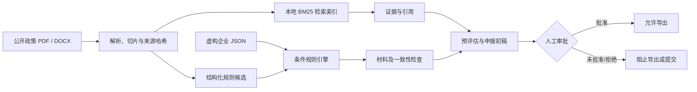

[简体中文](README.md) | [English](README.en.md)

# 制造业项目申报 Agent

一个可本地运行、引用可追溯、默认拒绝真实提交的制造业政策申报预评估系统。项目只使用工业和信息化部公开文件与虚构企业数据，适合作为 Agent/RAG 工程作品集。

当前首个可运行版本已实现：

- 读取公开 PDF、DOCX，生成本地检索索引；
- 提取日期、金额、比例、阈值和材料候选，正式规则保留人工复核；
- 将企业信息与政策硬性条件逐条匹配；
- 区分“申报窗口状态”和“企业条件状态”；
- 输出条件判断、原文页码/条款和官方链接；
- 检查缺失材料、财务比例和跨材料取值冲突；
- 生成不臆造未知信息的申报材料初稿；
- 记录完整执行轨迹；
- 导出前执行角色权限与人工审批门禁；
- 提供 FastAPI、Streamlit、CLI、自动测试和小型评测集。

## 演示政策

1. [2026年度智能工厂梯度培育行动](https://www.miit.gov.cn/zwgk/zcwj/wjfb/tz/art/2026/art_bbccc17a650749c2a76569679350fa5d.html)：演示日期 2026-08-10 时，卓越级线上申请截止日为 2026-08-15。
2. [2026年度专精特新“小巨人”认定和复核](https://www.miit.gov.cn/jgsj/qyj/wjfb/art/2026/art_83857a4773ac4583bd1540eeb78bcbcb.html)：线上填报期为 2026-04-25 至 2026-05-25，演示日期时已经截止。

两项国家通知均未明确承诺统一财政补助金额，因此系统返回“未明确”，而不是生成一个看似合理的数字。

## 快速运行

```powershell
cd D:\Xinhua\Agent\manufacturing-project-agent
python -m venv .venv
.\.venv\Scripts\Activate.ps1
pip install -e ".[dev]"
```

启动可视化界面：

```powershell
streamlit run app.py
```

启动 API：

```powershell
uvicorn manufacturing_agent.api:app --reload
```

打开 `http://127.0.0.1:8000/docs` 可直接调用交互式 API。

运行 CLI 演示：

```powershell
manufacturing-agent-demo --company huaxin_precision --as-of 2026-08-10
```

重建公开文档检索索引并显示文件哈希：

```powershell
python scripts/ingest_sources.py
```

运行测试与评测：

```powershell
pytest
python scripts/evaluate.py
```

## 核心流程



设计原则是“语言模型负责理解和起草，确定性代码负责硬条件、计算、权限和审计”。当前离线版本用可复现的规则和模板完成核心闭环，不需要 API Key；后续可以在不改变规则与审批边界的前提下接入大模型增强段落写作。

## 数据与隐私边界

- `data/raw/`：来自工业和信息化部官网的公开政策及申请表；
- `data/companies/`：三家完全虚构的企业；
- `data/policies/`：经人工复核的结构化规则和引用；
- `data/runtime/`、`exports/`：运行时生成，默认不进入 Git；
- 公开演示模式拒绝处理 `fictional=false` 的企业档案；
- 项目不会连接真实申报平台，也没有真实提交工具。

本项目不能用于替代政策主管部门、律师、会计师或企业内部审批。政策可能更新，正式使用前必须重新核验最新官方文件。

## 权限模型

| 操作 | analyst | approver | admin |
|---|---:|---:|---:|
| 评估、检索、生成草稿 | 是 | 是 | 是 |
| 决定审批 | 否 | 是 | 是 |
| 导出审批后的材料 | 否 | 是 | 是 |
| 真实对外提交 | 未实现 | 未实现 | 未实现 |

API 中的 `X-Role` 只是本地演示角色，不能作为生产身份认证。生产化必须替换成组织身份系统、细粒度授权和不可篡改审计存储。

## 项目结构

```text
manufacturing-project-agent/
├─ app.py                         # Streamlit UI
├─ data/
│  ├─ raw/                        # 官方公开原始文件
│  ├─ policies/                   # 结构化政策与逐条引用
│  ├─ companies/                  # 虚构企业档案
│  └─ evals/                      # 黄金评测样例
├─ src/manufacturing_agent/
│  ├─ ingestion.py                # PDF/DOCX 入库与哈希
│  ├─ retrieval.py                # 中文友好的本地 BM25 检索
│  ├─ eligibility.py              # 硬条件与材料判断
│  ├─ consistency.py              # 数值、比例和跨材料一致性
│  ├─ drafting.py                 # 事实约束的申报材料初稿
│  ├─ workflow.py                 # Agent 工作流、审批、审计
│  └─ api.py                      # FastAPI
├─ scripts/                       # 入库、抽取检查、评测
└─ tests/                         # 工作流与权限测试
```

更详细的设计和安全边界见 [架构说明](docs/ARCHITECTURE.md)、[安全与数据说明](SECURITY.md) 和 [演示脚本](docs/DEMO.md)。

## 许可证

代码使用 MIT License。原始政策文件的权利与使用条件归发布机关及原权利人所有，仓库仅为引用、核验和教学演示保存公开副本及来源链接。
